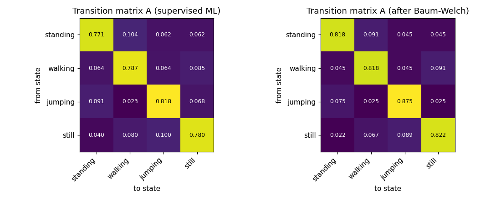
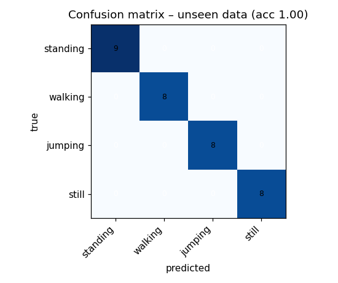
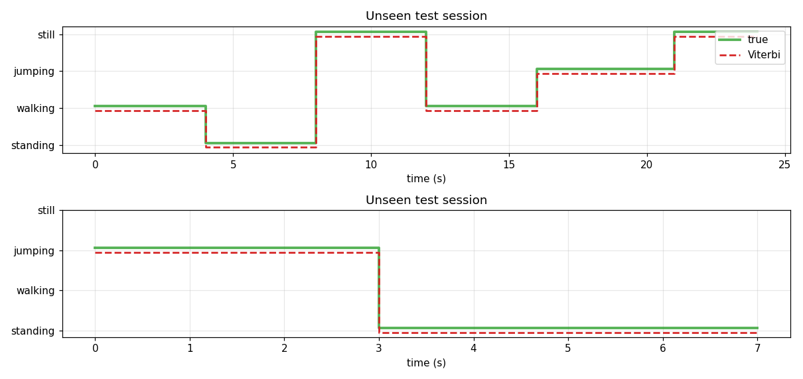

# Human Activity Recognition with a Hidden Markov Model

A Hidden Markov Model that recognises four activities (standing, walking, jumping and still) from the
accelerometer and gyroscope of a phone. The HMM is written from scratch with NumPy.

- **GitHub:** https://github.com/nehemmy55/Hidden-Markov-Models
- **Report:** [Report.pdf](Report.pdf)
- **Videos:** [Standing](https://drive.google.com/file/d/1fgJnANDfjqRZ35PLkdA3MfsvnkB807pz/view?usp=drive_link) · [Walking](https://drive.google.com/file/d/1F0WzvYTYVZfdjYsy_nc4VlF0ii9tCYWN/view?usp=drive_link) · [Jumping](https://drive.google.com/file/d/1HEI5BhoGEFdu5oM_bxG0uACZN-lbGa-U/view?usp=drive_link) · [Still](https://drive.google.com/file/d/13hjMlRoVJ4XSaRHSXrhMx0OnRFVN-Vqj/view?usp=drive_link)

This is a course project (Formative 2). The test set is small and comes from one person and one phone,
so the results should not be generalised.

## What the project is about

A phone measures movement all the time, but the activity behind the signal is hidden in noisy data.
My use case is exercise and rehabilitation monitoring, where it matters whether someone is walking or
jumping. I recorded my own data and built an HMM that infers the hidden activity from features of the
signals, then tested it on recordings it had not seen.

## Data

All data is real and recorded by me with the Sensor Logger app on an iPhone 11 (about 100 Hz,
resampled to 50 Hz). Each file is 5 to 8 seconds long.

| Activity | Files | Total time (s) |
|---|---|---|
| Standing | 13 | 91.8 |
| Walking | 13 | 93.0 |
| Jumping | 13 | 92.1 |
| Still | 14 | 96.9 |

Recordings 12 and 13 of each activity (8 files) are the unseen test set. The other 45 files are used for
training. `prepare_dataset.py` merges the accelerometer and gyroscope exports into one CSV per recording.
The accelerometer version that keeps gravity is used, because it shows how the phone is held.

## How it works

1. **Pre-processing.** Clean the rows, smooth, resample to 50 Hz and trim 1.0 s at the start and 0.5 s at
   the end of each recording.
2. **Windows.** 2 s windows (100 samples) with 50% overlap. This gives 182 training and 33 test windows.
3. **Features.** 19 features per window: time-domain (mean, standard deviation, RMS, SMA, axis correlation)
   and frequency-domain from the FFT (dominant frequency, spectral energy, spectral entropy). They are
   z-scored with the training data only.
4. **Model.** Four hidden states, one Gaussian per state for the emissions. The model is first fitted from
   the labels and then refined with Baum-Welch (stops when the log-likelihood change is below 1e-5).
   Viterbi decodes the activity of each window.

The recordings contain only one activity each, so the transition matrix is estimated from sessions made
by joining shuffled recordings. It reflects this joining and not real behaviour.

## Results

On the 33 unseen windows, every window was classified correctly (overall accuracy 100%).

| Activity | Windows | Sensitivity | Specificity |
|---|---|---|---|
| Standing | 9 | 1.00 | 1.00 |
| Walking | 8 | 1.00 | 1.00 |
| Jumping | 8 | 1.00 | 1.00 |
| Still | 8 | 1.00 | 1.00 |



Transition matrix from the labels (left) and after Baum-Welch (right).



Confusion matrix on the unseen recordings.



What I take from this:

- Jumping and still were never confused with anything. Standing and walking were the hardest pair.
- Before trimming, the model made 2 errors (95.6%), both in the first window of the standing test files.
  Part of this came from a bug in my first smoothing step, which I fixed. I chose the trimming after
  seeing these errors, so the result should be read with care.
- Baum-Welch gave the same test result as the label-based fit, so it added little.
- The dominant frequency follows a real rhythm for walking (mostly 1.0 Hz) and jumping (mostly 1.5 Hz),
  but only noise for standing and still.

## Limitations

- One person, one phone and one day, and only 33 test windows.
- The test recordings were made on the same day as the training ones.
- The transition matrix comes from joined recordings, not from real continuous behaviour.
- No other phone was used, so the sampling-rate harmonisation was only tested on one rate.

## Running it

```bash
pip install -r requirements.txt
python prepare_dataset.py --test-idx 12 13    # only to rebuild data/ from raw/
jupyter notebook hmm_activity_recognition_final.ipynb    # restart and run all cells
python -m pytest tests
```

## Files

```
hmm_activity_recognition_final.ipynb   the notebook with the code and results
prepare_dataset.py                     builds data/ from raw/
data/                                  train and test CSV files
raw/                                   original Sensor Logger exports
figures/                               plots made by the notebook
tests/                                 unit tests (forward-backward, Viterbi, Baum-Welch, metrics)
Report.pdf                             the report
```

## References

- Rabiner, L. R. (1989). A tutorial on hidden Markov models and selected applications in speech recognition. Proceedings of the IEEE, 77(2), 257-286.
- Baum, L. E., et al. (1970). A maximization technique occurring in the statistical analysis of probabilistic functions of Markov chains. Annals of Mathematical Statistics, 41(1), 164-171.
- Viterbi, A. J. (1967). Error bounds for convolutional codes and an asymptotically optimum decoding algorithm. IEEE Transactions on Information Theory, 13(2), 260-269.
